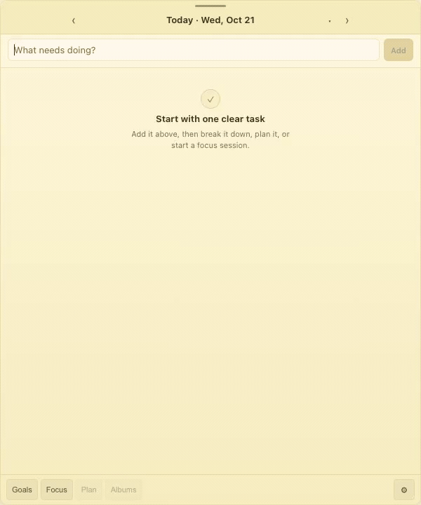

# Sticky Todo

Cross-platform sticky note todo planner with AI task breakdown.

## Install

Download the latest installer from [Releases](https://github.com/2Mars4096/todo-sticky/releases):

| Platform | File |
|----------|------|
| **macOS** (Intel + Apple Silicon) | `.dmg` |
| **Windows** | `.msi` or `.exe` |
| **Linux** | `.deb` or `.AppImage` |

First launch opens the task list with the **New task** field ready. Type a task and press **Enter** or **Add**. AI setup is optional and can wait until you need it.

Open **Settings** to configure tools by purpose:

| Section | What it contains |
|---------|------------------|
| **Tasks & storage** | Current task folder and **Change task folder**. The default is `~/Documents/Sticky Todo`; task files live in `content/to-do/` inside it. |
| **AI assistance** | Provider and key, with **Model and connection options** and **Scheduling machines (optional)** available on demand. |
| **Integrations** | Optional Dear Diane task handoff and reuse of matching local Diane credentials. |
| **Updates** | Check for, download, and install app updates. |

For AI assistance, choose Moonshot, OpenRouter, OpenAI, Anthropic, Gemini, a custom OpenAI-compatible endpoint, or **Codex (ChatGPT login)**. API providers use their configured endpoint, key, and model. Codex reuses your existing local `codex login`; its model can be blank, and its executable defaults to `codex` with common install paths detected. Use **Test connection**, then save the settings.

The window appears after the app shell is ready; a short fallback keeps startup errors visible if frontend loading fails.

On macOS, the default task folder and local app-state folder stay anchored to the signed-in account, so launching Sticky Todo from an installer or automation tool cannot silently open a separate empty data store.

If macOS or Dropbox has offloaded the Markdown archive, Sticky Todo reports **Tasks are waiting in Dropbox** instead of treating the archive as empty or waiting forever. Reveal the configured `content/to-do/.../index.md` file in Finder, choose **Make available offline** or **Download now**, then use **Retry** after the file becomes local.

By default, Todo uses Diane’s existing OpenRouter, OpenAI or Moonshot key on the same computer when the provider URL matches, then falls back to Todo’s own key. Diane does not need to be open. Turn off **Use Diane credentials when available** in **Settings → Integrations** to use Todo’s key exclusively. Existing `.env` files, keys and model choices are preserved; there is no Keychain access or cross-device sync. Launch an updated Diane once to advertise its file locations; older installs can use the existing `~/.dan/graphs_dir` marker.

Each provider keeps its own API URL, key, and last-used model. Switch providers in **Settings → AI assistance**; wider windows also show a quick selector beside Settings. Choosing an unconfigured provider opens its setup.

> macOS Gatekeeper may warn about an unsigned app. Right-click → **Open** to bypass.

## Update

The app checks for updates at launch and every 15 minutes, including overdue checks when you return. A dot on **Settings** marks an available update, and another dot marks **Download and install** or **Restart now** inside Settings. Checks run quietly; installation and restart stay manual.

You can also open **Settings → Updates → Check for updates**. When a newer release is available, choose **Download and install**, then **Restart now**. Windows restarts through its installer. Save changed settings and finish any focus session first. Tasks and settings stay in their existing storage.

Version 2.1.0 introduces in-app updates. Older installations need one manual upgrade to this version; later published GitHub releases can be installed from the app.

### Publish an update

Run `npm run release` from a clean `main` branch after committing the changes. This bumps the patch version and pushes its version tag. GitHub Actions builds signed installers for macOS, Windows, and Linux, validates the complete `latest.json`, and publishes the release when all builds succeed. A normal branch push does not publish an app update. If packaging fails, fix the workflow on `main`, then run `gh workflow run release.yml -f release_tag=v2.1.0` with the failed version tag; the retry builds that exact tagged source without moving the tag.

The workflow needs the repository secret `TAURI_SIGNING_PRIVATE_KEY` and, for an encrypted key, `TAURI_SIGNING_PRIVATE_KEY_PASSWORD`. Keep a backup of the original signing key; replacing it breaks trust for existing installations. For a local release build, set `TAURI_SIGNING_PRIVATE_KEY` to the key file path and `TAURI_SIGNING_PRIVATE_KEY_PASSWORD` to its password (empty for the current key). Never commit the private key.

## Demo

<p align="center">
  
</p>

## Features

Click an unfinished task to select it. Icon buttons for **Focus**, **Add step**, **Suggest steps with AI**, **Move**, and **Delete** appear beside its details. Hover to see each action name. Double-click the title or press Enter while the title is focused to edit it. Enter saves; Escape cancels.

- **Persistent capture** — The top **New task** field stays visible. Add step opens a visible inline field for the selected task; Enter adds the step and Escape clears its draft.
- **Readable task hierarchy** — Titles lead, saved Outcome and Due details sit beneath them, and step groups collapse to a count and next-step summary. Expand a group to work through it.
- **Task actions** — AI step suggestions and moving are available directly. Delete is also directly available; deletion offers Undo. Drag the six-dot handle to reorder tasks or steps within one task.
- **Compact shell** — Named **Goals** and **Focus** controls replace idle side columns in small windows. The active Focus countdown stays visible; expanded tools overlay the note. Wider windows can show side panels.
- **Predictable launch placement** — Fresh launches open at the top-right of the current display with a safe screen-edge margin; after that, the app respects wherever you drag it
- **Task completion** — Tasks without an Outcome retain the todo → done → partial cycle and completion of their parent when its current-day steps are done. Tasks with an Outcome require **Complete / Revise / Stop** review. Completing a parent completes its steps; stopping remains a separate decision.
- **Earlier unfinished work** — Today collects unfinished past tasks under **Earlier tasks**, with their source dates. The collapsed section remembers your choice, loads separately from Today, and offers Show more in batches of 40. Edits stay in the original Markdown date.
- **Smart carry-forward** — Move unfinished past work directly to today; moving one subtask preserves its parent on the destination date and merges later sibling moves beneath it. A single-line confirmation shows the destination
- **Date navigation** — Jump between days with fixed-position prev/next arrows and a centered calendar label; empty past/future dates offer a direct return to today. The Today marker refreshes at midnight and when you return to the app, advancing an open Today view while preserving explicitly browsed dates
- **Native clipboard** — Use standard Command-C and Command-V while editing; the task action row stays limited to Focus, Add step, AI suggestions, Move and Delete
- **Agent task API** — Extract, create, edit, and delete Markdown-backed tasks from reusable skills through a local JSON CLI, with revision checks for safe writes
- **Task history** — **Earlier steps (N)** within a task reveals its read-only historical steps; these stay collapsed by default
- **AI assistance** — Explicitly request outcome suggestions, step breakdowns, or a proposed day plan when useful. Selecting a task does not make an AI request.
- **Codex background provider** — Run breakdowns, schedules, and album picks through the locally authenticated Codex CLI in an ephemeral read-only workspace, without adding an OpenAI API key
- **Task-aware albums** — Find four albums suited to the concentration, energy, and atmosphere of the work, in a compact list with musical reasons and listening-mood cues (requires a configured AI provider)
- **Goals and Routines** — Keep long-term goals and reusable reminders in flat lists. Routines are reset manually; they do not create tasks on a schedule. Type and press Enter to add, double-click or press Enter on a focused item to edit, and Escape to cancel.
- **Star Focus** — Select a task, choose a duration, then **Start focus**. **Pause**, **Resume**, and **Finish session** control the timer. Sessions travel the Solar Route and enter a native-local log with `6` / `12` / `24` retention presets. Session completion leaves task-outcome review to you. A simplified map keeps controls working if 3D rendering is unavailable, and **Try 3D again** retries it.
- **Undo and save recovery** — Deleting a task or applying a day plan offers **Undo**. Failed writes keep edits in memory and show a persistent **Changes not saved** notice with **Retry save**. Pending saves must finish before switching dates or task folders.
- **File sync** — Tasks stored as Markdown in `content/to-do/`; edits sync both ways
- **Always on top** — Sticky window stays visible; runs in the menu bar with a tray icon
- **Native shell** — Built with Tauri and the platform WebView

### Outcomes and due dates

Select an unfinished task to add an optional **Outcome** or **Due** date. Saved details remain visible when the task is unselected. Write the outcome yourself, or choose **Suggest outcome** in an empty editor. The response is labeled **AI suggestion · not saved**. **Use suggestion** (or Tab in the empty outcome field) copies it into your draft; Enter or leaving the editor saves, and Escape cancels.

Date changes are drafts until **Save date** or Enter. **Clear date** edits the draft; **Cancel** or Escape preserves the saved date. Deadline history records the original date and subsequent changes. Carrying a task forward keeps its due date.

AI step suggestions use the outcome and date to propose bounded work including a closing action. When an outcome is ready to review, choose **Complete**, **Revise**, or **Stop**. Stopped tasks stay distinct from completed work and do not carry forward.

### Review a day plan before applying it

Open **Plan** for the selected date, set your available **From / Until** times, and optionally select configured machines. **Generate proposal** shows chronological blocks and any tasks left unscheduled. Generating a proposal does not change your tasks.

Choose **Apply plan** to add the blocks, or **Discard** to leave the tasks as they were. Replanning replaces unfinished generated blocks for that planning date while retaining manual and completed work. The confirmation offers **Undo**. If tasks or planning details change during review, generate a fresh proposal before applying it.

## Development

```bash
# Prerequisites: Node.js 18+, Rust (https://rustup.rs)

npm install
npm run dev
```

This starts Vite on port 5173 and launches the Tauri window.
In development builds, a `Dev` button appears in the bottom action bar so you can seed sample tasks, clear the current day, reload task state, and slow down or fast-forward Star Focus mission time.

| Command | Description |
|---------|-------------|
| `npm run dev` | Start app (Vite + Tauri) |
| `npm run dev:vite` | Vite-only (no native window) |
| `npm test` | Run the Node regression suites |
| `npm run build:frontend` | Build the frontend for preview or packaging |
| `npm run build` | Build distributable for current platform |
| `npm run task-api -- --help` | Show the local JSON task API used by agent skills |
| `npm run release` | Bump patch version, tag, and push (triggers CI) |

### Tests

Run `npm test` for the Node regressions and `npx tsc --noEmit` for TypeScript checking. Browser checks use synthetic task/settings data and mocked native services, without accessing an installed app, user archives, credentials, or live AI.

With Playwright available, run `npm run build:frontend`, then start a production preview with `npm run preview -- --host 127.0.0.1 --port 4173`. In another terminal:

```bash
TODO_TEST_URL=http://127.0.0.1:4173 node tests/check-refined-shell.cjs
TODO_TEST_URL=http://127.0.0.1:4173 node tests/check-task-interactions.cjs
TODO_TEST_URL=http://127.0.0.1:4173 node tests/check-focus-refinements.cjs
```

The shared `tests/helpers/browser-fixture.cjs` also accepts `PLAYWRIGHT_MODULE` (module name or path), `CHROME_EXECUTABLE`, `CHROMIUM_ARGS` (a JSON array of strings), and optional `CHROME_LIBRARY_PATH` / `CHROME_FONTCONFIG_PATH` for an existing Chromium runtime. `TODO_TEST_URL` can point to Vite instead; it defaults to `http://127.0.0.1:5173`. Set `TODO_TEST_OUTPUT` to a directory to save optional screenshots and reports. The Focus suite needs WebGL2 support and deliberately exercises graphics failures.

## Agent Task API

The repository includes a local command API that resolves the knowledge-base path from the app's saved settings and prints machine-readable JSON:

```bash
npm run task-api -- extract --date 2026-08-16
npm run task-api -- create --date 2026-08-16 --text "Review notes" --subtask "Mark key claims"
npm run task-api -- edit --date 2026-08-16 --id TASK_ID --status done --expected-revision REVISION
npm run task-api -- delete --date 2026-08-16 --id TASK_ID --expected-revision REVISION
```

Use `--kb-path PATH` or `STICKY_TODO_KB_PATH` to override path discovery. See [docs/llm-api-guide.md](docs/llm-api-guide.md) for the JSON contract and skill-safe workflow.

## Releasing

Releases are automated via GitHub Actions. To publish a new version:

```bash
npm run release        # bumps patch (2.0.0 → 2.0.1), creates tag, pushes
# or manually:
npm version minor      # 2.0.0 → 2.1.0
git push --follow-tags
```

The workflow builds for **macOS** (universal binary), **Windows**, and **Linux**, then uploads them as a draft GitHub Release. After all platform builds and manifest/asset checks pass, the workflow publishes it as the latest release. Users can install it through **Settings → Updates**.

## Shortcuts

| Shortcut | Action |
|----------|--------|
| **⌥⌘T** / **Ctrl+Alt+T** (Windows) / **Ctrl+Shift+Alt+T** (Linux) | Show/hide window (global) |
| **⌘Q** / **Ctrl+Q** | Quit (app/menu shortcut) |
| **Enter** | Add task / submit subtask or goal / commit edit |
| **Escape** | Close a dialog or compact side panel; cancel a title, outcome, date, or step draft |
| **Drag the six-dot handle** | Reorder a task with its steps, or a step within its parent; Escape cancels the drag |
| **Arrow Up / Arrow Down** | Move a task or subtask after clicking or tabbing to its six-dot handle |
| **Drag any window edge or corner** | Resize the frameless window; the bottom-right grip is always visible |
| **Double-click** | Edit task text |

## Run in Diane (companion update required)

Diane is optional. Todo opens, saves, and manages your tasks, dates, goals and focus without it. If Diane is disconnected or unavailable, only its dispatch/status controls are affected. Independently configured AI providers continue to use their own configuration.

In **Settings → Integrations**, enable **Connect to Dear Diane on this computer** and Save. It is off by default; off hides task controls and stops connection attempts without deleting session links or stopping existing Diane runs. The separate credential preference controls key reuse. Open Dear Diane and select the project/folder you want to use; Settings shows that destination when you enable the connection. The simplified task row currently omits Diane dispatch controls. Existing integration settings and stored links are preserved.

Closing Todo leaves Diane working. Reopening reconnects; a disconnected indicator does not mean the run failed. Reconnect reuses the original dispatch and does not submit edits made afterward. Todo 2.1.7 includes the Todo side of this integration; running tasks requires the separate Diane companion update.

For an isolated native development launch:

```sh
STICKY_TODO_DEV_DATA_DIR=/private/tmp/sticky-todo-diane-data npm run tauri -- dev --config src-tauri/tauri.diane-dev.conf.json
```

Browser controls can be checked without native data or an agent: run Vite on port 15173, then `python tests/check_diane_ui.py` with Python Playwright installed. `CHROME_EXECUTABLE` and `TODO_TEST_URL` override the test browser and preview URL.

Settings uses one navigation row (Storage, AI, Integrations, Updates) and a stable viewport-bounded dialog height. Longer sections scroll internally while the header and Save/Cancel controls stay in place.
